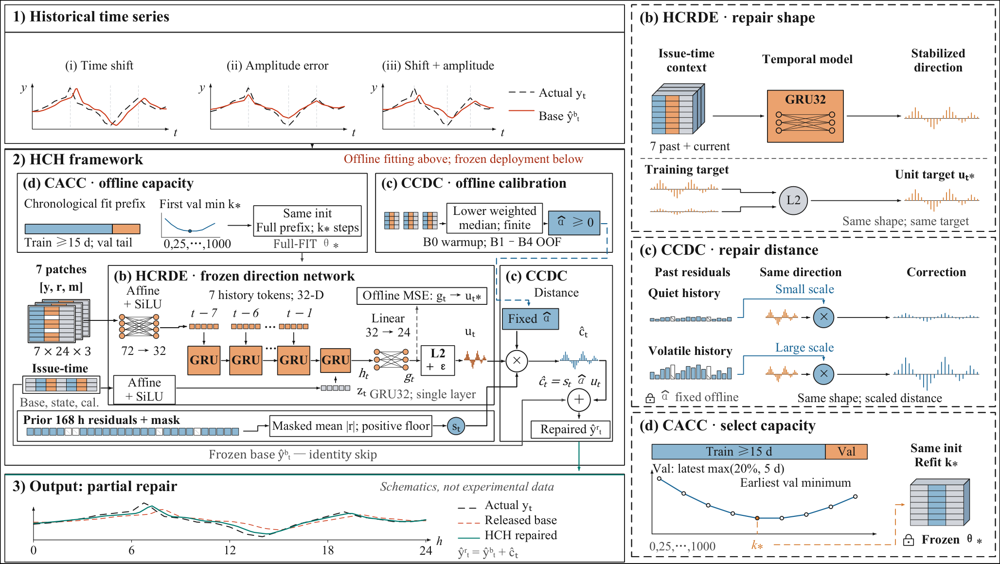
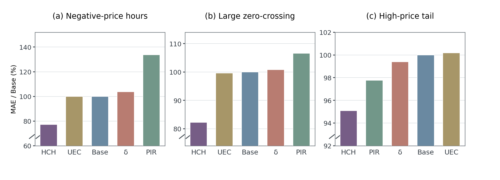

<div align="center">
  <h2>HCH: History-Calibrated Horizon Repair for Frozen Time-Series Forecasts</h2>
</div>

This repository contains the implementation of **History-Calibrated Horizon Repair (HCH)**, a lightweight correction method for frozen multi-horizon forecasters. HCH learns a history-conditioned correction direction and calibrates its magnitude from chronological out-of-fit residual evidence, without retraining the forecasting backbone.

<p align="center">
  
</p>

## Dependencies

The HCH package supports Python 3.10+ and PyTorch 2.1+ with NumPy and Pandas. The example and tests can run on CPU. The paper's main experimental environment uses Python 3.10, PyTorch 2.1.2, CUDA 11.8, and an NVIDIA RTX 4090D.

```bash
python -m pip install -e ".[test]"
```

## Datasets

The experiments cover **11 electricity markets** and four frozen forecasting backbones (PatchTST, TimeMixer, iTransformer, and LSTM).

- **Australia (NEM South Australia):** [hourly 2024 data](data/foreign/NEM_SA1/SA1_2024_hourly.csv) and [AEMO attribution](data/foreign/NEM_SA1/README.md).
- **Germany, PJM, and Nord Pool:** [original EPF benchmark datasets](https://zenodo.org/records/4624805). The repository includes a [source download helper](scripts/fetch_epftoolbox.py).
- **Other external markets:** see the [dataset source list](data/foreign/README.md).

Chinese market data release is coming soon, subject to institutional authorization. These data are not included in the current release.

## Usage

**Quickstart** — a self-contained synthetic example of chronological fitting, calibration, and issued-forecast correction:

```bash
python examples/quickstart.py --output outputs/synthetic_quickstart
```

**Fit and predict** — use prepared, issue-time-legal Base forecast caches:

```bash
python scripts/hch_cli.py fit --issued fit_issued.npz --train-truth fit_truth.npz --output bundle.npz
python scripts/hch_cli.py predict --issued eval_issued.npz --bundle bundle.npz --output predictions.npz
python scripts/hch_cli.py score --prediction predictions.npz --truth eval_truth.npz
```

The quickstart uses synthetic data; the published market experiments use their original frozen-forecast inputs. Input formats are described in the [data interface](data/README.md). Original four-forecaster issued-prediction caches and the complete 44-configuration replay pipeline are not included in this public release.

## Experimental Results

**Overall accuracy.** The table summarizes the paper's Base-normalized MAE across **44 market–forecaster configurations**. Base is 100; **lower is better**. These are reported experimental results, not outputs of the synthetic quickstart.

| Evaluation group | Base | HCH |
| :-- | --: | --: |
| Five Chinese development markets | 100.00 | **91.19** |
| Additional development markets | 100.00 | **90.97** |
| Confirmation markets (DK1 and NEM-SA1) | 100.00 | **95.55** |
| **All 44 configurations** | **100.00** | **91.90** |

**Difficult price conditions.** The figure compares Base, HCH, PIR, δ-Adapter, and UEC-STD on negative-price hours, large zero crossings, and upper-price tails. The values are MAE relative to each matched frozen Base (100%); lower is better.

<p align="center">
  
</p>

Additional seedwise results, component ablations, and robustness analyses are available in the [Supplement](docs/supplement.pdf).

## Citation

Please cite the HCH manuscript when its bibliographic record becomes available. Author information is provided in [CITATION.cff](CITATION.cff).

## Contact

School of Information Science and Engineering, East China University of Science and Technology, Shanghai, China.

- **Letian Zhang:** letianzhang@mail.ecust.edu.cn
- **Weichao Ding:** weich@ecust.edu.cn
- **Haohua Duan:** duanhaohua@ecust.edu.cn
- **Qingyang Liu:** qingyang.liu@ecust.edu.cn
